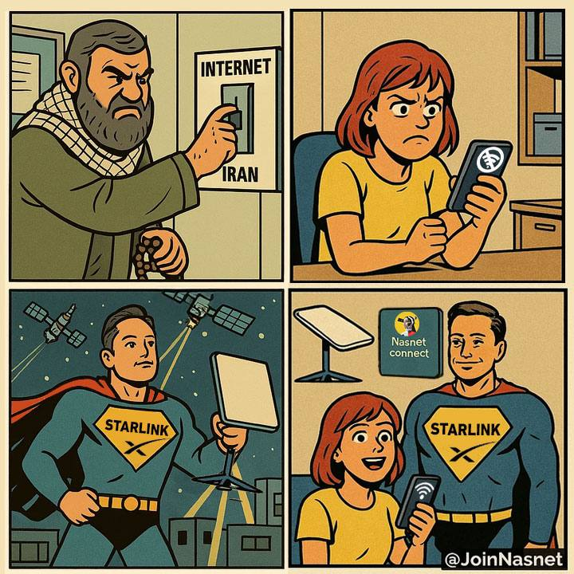

<h1 align="center">🛰️ NasNet Community</h1>

<b>Free internet, for everyone, everywhere — no matter who's trying to switch it off.</b>

  
  
  

  
  

  

  

**NasNet** builds tools for **safely using Starlink and similar satellite internet in repressive and censored environments**, such as Iran. When governments cut the cables, we look to the sky. 🚀

In countries with heavy censorship and frequent internet shutdowns, satellite internet is a lifeline — but using one can put you at risk. That's where we come in. Our mission: get people onto the free and open internet **safely** — hiding the fact that a satellite connection is in use, protecting the identity and location of operators and users, letting one dish be safely shared with many people over VPN, and making it all simple enough that you don't need to be a network engineer to stay safe.

## 🔥 What we're about

- 🛡️ **Safe Starlink usage in censored regions** — IP masking to hide the digital footprint of using a Starlink (or similar) connection when accessing domestic sites and apps
- ⚡ **Resilience against internet shutdowns** — connectivity that keeps working when the national network goes dark
- 🤝 **Community connection sharing over VPN** — one dish doesn't have to mean one household. Turn a single satellite connection into a lifeline for your neighbors, your street, your city — locally over WiFi, and remotely through encrypted VPN tunnels
- 🧭 **Radical accessibility** — automated, easy-to-follow setups so anyone can protect themselves, no expertise required

## 📡 One dish, many people: sharing Starlink over VPN

A Starlink dish is scarce and expensive in places like Iran — but a single dish can carry far more than one household. Our tools let a dish owner run a **VPN server on their own router**, or hand out access from a server they control, so that trusted friends, family, and neighbors can tunnel through the satellite connection from wherever they are:

- 🏠 **Next door** — neighbors join over the WiFi networks your router broadcasts, set up for you in a few clicks
- 🌆 **Across the city** — people still on the domestic network connect through an encrypted VPN tunnel and come out on the free internet via your dish, even mid-shutdown
- 🕶️ **Safely** — the tunnel is encrypted end-to-end, the Starlink's digital footprint stays masked, and you keep full control over who connects, for how long, and how much data they use

Every project below is built around this idea: **Nasnet Panel** turns a MikroTik router into a masked, VPN-sharing Starlink gateway, and **Nasnet Panel Linux** lets you hand out time- and traffic-limited access from your own server to the people you trust.

## 🚀 Our projects

### [Nasnet Panel](https://github.com/nasnet-community/nasnet-panel)
The flagship. A free, open-source web panel for MikroTik routers, built so you can set up and run a safe Starlink connection without living in Winbox or the RouterOS terminal. It ships as one small container that can run right on the router it manages. Packed with features:

- 🧭 **Easy Config wizard** — sets up your uplinks, a VPN client that masks the Starlink IP, WiFi, and an OpenVPN server for sharing, in a few guided steps
- 🔐 **VPN control center** — WireGuard, OpenVPN, IPsec, L2TP, PPTP, and SSTP tunnels, with peer and client monitoring
- 📊 **Real-time dashboard** — live CPU, memory, traffic, and interface status at a glance
- 🧱 **Firewall configuration** — filter, NAT, and mangle rules in a visual editor, with live connection tracking
- 📶 **Wireless management** — WiFi interfaces, security profiles, and connected clients
- 🔎 **Router discovery** — scans your network to find MikroTik devices automatically
- ↩️ **Batch operations** — bulk changes with dry-run mode and automatic rollback on failure
- 🧩 **Plugin marketplace** — one-click add-ons such as an MTProto proxy, an Xray server, and a Starlink dish monitor
- 📦 **Runs anywhere** — on the router itself or any Docker host, on amd64, arm64, and arm/v7

### [Nasnet Panel Linux](https://github.com/nasnet-community/nasnet-panel-linux)
Your own VPN service, on your own server. A free, open-source, self-hosted panel that runs Xray on a single Linux server, so you can share access with the people who need it without hand-editing a single config file:

- 🔌 **Modern protocols** — VLESS, VMess, Trojan, and Shadowsocks over TLS, REALITY, or XTLS, plus WireGuard
- 🔗 **One link for every app** — universal subscription links that detect the client (v2rayNG, v2rayN, Clash, sing-box, Shadowrocket) and serve the right config
- ⏱️ **Time- and traffic-limited accounts** — give each person their own subscription, with an expiry date and a data cap
- 📲 **Self-serve for users** — a personal page with live usage, QR codes, and one-tap import, plus an optional Telegram bot
- 🚨 **Metrics, alerts, and an audit log** — know when something goes wrong, with notifications to Telegram, Discord, or a webhook
- 🛠️ **Easy to install** — a one-line interactive installer, with Docker or systemd, automatic TLS, and backup and restore
- 🌍 **Multi-language** — English and Farsi

### More coming soon… 👀
We're cooking up new tools and solutions. Follow us on our socials above to be the first to know — you won't want to miss what's next.

## 💜 Get involved

All of our projects are **fully open-source** — built in the open, by the community, for the community. Whether you write code, test on real hardware, translate, design, document, or just have ideas, there's a place for you here. Jump into any of the repos above, open an issue or a pull request, or come chat with us on [Telegram](https://t.me/joinNASNETGroup). Every contribution helps keep someone connected. 🌐

---

⚠️ **A note on safety:** Using satellite internet in countries where it is restricted can carry serious legal and personal risks. Our tools aim to reduce those risks, but no tool can eliminate them entirely. Understand your local situation and threat model before deploying anything.
